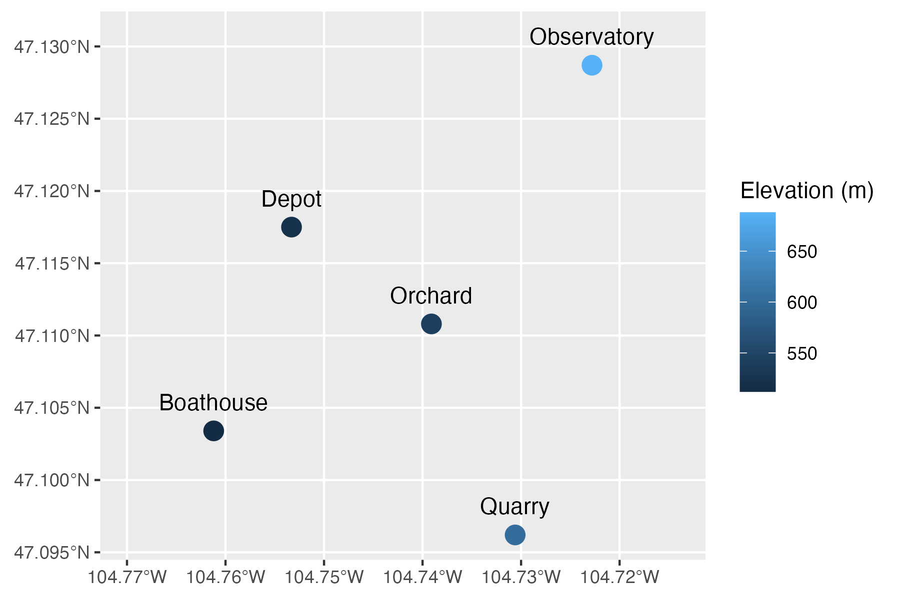

# Map point data with sf in MESA RStudio Geospatial

!!! warning "Draft: not yet validated"
    The code on this page was run inside MESA RStudio Geospatial on 2026-11-13 (R 4.6.2,
    sf 1.1.3) and produced the output and the map shown. Nobody else has yet followed
    the steps, so a screen may differ.
    [Tell us what you find](https://github.com/idss-mesa/trainings/issues).

A column of longitudes and a column of latitudes are only numbers until you tell R
they are positions. The `sf` package does that, and then distances and maps come from
the same object.

**You will:** have a map of the five practice gauges, saved as an image in your Data
Store.

**Time:** 10 minutes. **You need:** to be [signed in to the MESA Portal](sign-in.md),
and your CyVerse username.

## Steps

1. In the portal, click **Applications**, and on the **MESA RStudio Geospatial** card
   click **Instant Launch**. Wait for RStudio to open.

    You should see: RStudio, with the **Console** on the left and a **Files** tab at
    the bottom right that lists `data-store`.

2. Click in the **Console**. Run these lines, with your own username in the first:

    ```r
    setwd("~/data-store/home/<your username>")
    dir.create("mesa-practice", showWarnings = FALSE)
    setwd("mesa-practice")
    base <- "https://idss-mesa.github.io/trainings/assets/practice/"
    for (f in c("gauges.csv", "gauge_sites.csv")) download.file(paste0(base, f), f)
    ```

    You should see: `downloaded 135 bytes`, then `downloaded 144 bytes`.

3. Join the two tables and declare the coordinates:

    ```r
    library(sf)
    library(ggplot2)

    gauges <- read.csv("gauges.csv")
    sites <- read.csv("gauge_sites.csv")
    located <- merge(gauges, sites, by = "gauge_id")
    points <- st_as_sf(located, coords = c("longitude", "latitude"), crs = 4326)
    points
    ```

    You should see: five features, a `geometry` column in place of the two coordinate
    columns, and the coordinate reference system you declared. `4326` is WGS 84,
    ordinary longitude and latitude.

    ```text
    Simple feature collection with 5 features and 4 fields
    Geometry type: POINT
    Dimension:     XY
    Bounding box:  xmin: -104.7612 ymin: 47.0962 xmax: -104.7228 ymax: 47.1287
    Geodetic CRS:  WGS 84
      gauge_id        name unit elevation_m                  geometry
    1      G01   Boathouse   mm         512 POINT (-104.7612 47.1034)
    2      G02     Orchard   cm         540 POINT (-104.7391 47.1108)
    3      G03 Observatory   mm         688 POINT (-104.7228 47.1287)
    4      G04       Depot   mm         521 POINT (-104.7533 47.1175)
    5      G05      Quarry   mm         603 POINT (-104.7306 47.0962)
    ```

4. Check that R now treats them as positions, by asking for a distance:

    ```r
    boathouse <- points[points$name == "Boathouse", ]
    observatory <- points[points$name == "Observatory", ]
    round(st_distance(boathouse, observatory))
    ```

    You should see: the distance in metres, about four kilometres.

    ```text
    Units: [m]
         [,1]
    [1,] 4044
    ```

5. Draw the map:

    ```r
    ggplot(points) +
      geom_sf(aes(colour = elevation_m), size = 4) +
      geom_sf_text(aes(label = name), nudge_y = 0.002, fun.geometry = identity) +
      scale_x_continuous(expand = expansion(mult = 0.3)) +
      labs(colour = "Elevation (m)", x = NULL, y = NULL)
    ```

    You should see: the **Plots** tab come forward at the bottom right, with five
    labelled points.

    { width="520" }

6. Save it beside the data:

    ```r
    ggsave("gauge-map.png", width = 6, height = 4)
    ```

    You should see: no output. The map is now a file in your Data Store.

## Check it worked

In the portal, open **Data Browser → My Files → mesa-practice**. `gauge-map.png` is
listed there, which means it will outlast the app.

## If it didn't

**`cannot change working directory`** in step 2. The username in the path is not
yours, or is misspelled. In the **Files** tab, click **data-store**, then **home**:
the folder that is not `shared` is named after your username.

## Next

- [Stop an app and find your results](stop-app-find-results.md), when you have
  finished with RStudio.
- The coordinates are invented, like the rest of the [practice data](practice-data.md):
  they mark no real instruments.
- Reference: [MESA RStudio Geospatial](https://idss-mesa.github.io/docs/apps/rstudio/)
  for what the app contains, and
  [Simple Features for R](https://r-spatial.github.io/sf/articles/sf1.html).

*Not yet validated by a second person in MESA RStudio Geospatial. Drafted 2026-11-13; the code was run there on 2026-11-13 (R 4.6.2, sf 1.1.3).*
